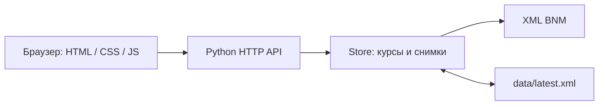

# 💱 Курс · Конвертер валют BNM

**Лабораторная PSI №3.** Веб-приложение для конвертации валют по официальным курсам Национального банка Молдовы с выбором даты и постоянным кэшем.


[Запуск](#быстрый-запуск) · [Как пользоваться](#как-пользоваться) · [Тесты](#тестирование) · [Архитектура](#структура-и-поток-данных) · [Отчёт](REPORT.md)

## Возможности

- Конвертация в обе стороны и обмен исходной/целевой валют.
- Выбор даты курса; отображение источника и даты полученных данных.
- Проверка суммы, поддержка десятичной точки и запятой.
- Нормализация валют с номиналом 10/100 на одну единицу.
- Сохранение последнего успешного ответа BNM между запусками.
- Понятная ошибка сети и явный выбор сохранённого курса.

## Стек

| Часть | Технологии |
|---|---|
| Сервер | Python 3.12, стандартный `http.server.ThreadingHTTPServer` |
| Интерфейс | HTML, CSS, JavaScript, Fetch API |
| Расчёты | `decimal.Decimal`, округление до двух знаков |
| Источник | XML API BNM, `urllib.request`, `xml.etree.ElementTree` |
| Хранение | Файл `data/latest.xml`; снимки курсов в памяти сервера |
| Тесты | pytest, unittest.mock; локально подготовлен Selenium-набор |
| Окружение | Docker Compose, Git/GitHub, Spec Kit 1.2.4 |

Flask, Django, React и отдельная база данных не используются.

## Быстрый запуск

### Docker

В Windows нужен Docker Desktop с работающим Linux-движком / WSL 2.

```powershell
git clone https://github.com/aristique/ai-currency-web.git
cd ai-currency-web
docker compose up --build -d lab3
```

Откройте **[http://localhost:8083](http://localhost:8083)**.

```powershell
docker compose logs lab3
docker compose down
```

Первая команда показывает логи, вторая останавливает и удаляет контейнер. Папка данных остаётся.

### Без Docker — Python 3.12, PowerShell

```powershell
python -m venv .venv
.\.venv\Scripts\python.exe -c "print('Python готов')"
$env:PYTHONPATH = "$PWD/src"
$env:DATA_DIR = "$PWD/data"
.\.venv\Scripts\python.exe -m currency
```

Этот способ открывает сервер на **[http://localhost:8080](http://localhost:8080)**; порт 8083 относится к Docker-пробросу или подготовленному Windows-launcher. Для работы сервера сторонние Python-пакеты не нужны. Остановка — Ctrl+C.

## Как пользоваться

1. Дождитесь загрузки курса: появятся валюты, дата и статус.
2. Введите положительную сумму и выберите валютную пару.
3. Нажмите **«Конвертировать»**. Кнопка ⇄ меняет валюты местами.
4. При необходимости выберите дату или нажмите **«Обновить курс»**.
5. Если источник недоступен и кэш существует, нажмите предложенную кнопку использования сохранённого курса.

Допустимая сумма: больше нуля и не более 10¹⁵. Одинаковые валюты обрабатываются корректно. История пользовательских конвертаций не записывается.

### Формула

```text
Курс одной единицы к MDL = Value / Nominal
Результат = сумма × курс исходной валюты к MDL / курс целевой валюты к MDL
```

Если ответ на выбранную дату пуст, проверяются 14 предыдущих дней. Корректный ответ выходного дня используется как опубликован. При сетевой ошибке приложение предлагает кэш, а не выдаёт сохранённые данные за новые.

## Кэш и работа без сети

`data/latest.xml` содержит последний успешно полученный реальный ответ BNM. Он сохраняется при перезапуске и удалении контейнера. Для первой загрузки нужен интернет; без файла кэша офлайн-конвертация невозможна.

Для демонстрации заранее получите курс, затем проверьте ошибку обновления и выберите сохранённые данные. Дата кэша отображается явно. Файл не включается в Git и не встраивается в Docker-образ.

## Тестирование

### Unit- и HTTP-тесты

```powershell
docker compose run --build --rm tests
```

Без Docker:

```powershell
.\.venv\Scripts\python.exe -m pip install -r requirements-test.txt
$env:PYTHONPATH = "$PWD/src"
.\.venv\Scripts\python.exe -m pytest tests -v
```

| Где | Что проверяется |
|---|---|
| [tests/test_rates.py](tests/test_rates.py) | XML, номиналы, обе стороны конвертации, ввод, даты и постоянный кэш |
| [tests/test_http.py](tests/test_http.py) | Настоящий HTTP-сервер, API, ошибки, кэш и доступные статические файлы |

30 тестов проходили в Linux Docker и повторно на Windows. Проверены реальный ответ BNM, конвертация и повторное чтение сохранённого курса.

### Selenium — дополнительная локальная проверка

На Windows отдельно подготовлены `ui_tests/test_browser.py` и `requirements-ui.txt`: **10 проверок Chrome прошли**. На момент обновления этого README эти файлы ещё находятся в локальных изменениях и не входят в опубликованную версию репозитория. После их публикации команда запуска:

```powershell
python -m pip install -r requirements-ui.txt
$env:PYTHONPATH = "$PWD/src"
$env:SELENIUM_HEADED = "1"
python -m pytest ui_tests -v
```

Проверяются ввод, конвертация, обмен валют, номинал, дата, сбой источника и восстановление из кэша. Используются настоящий Chrome, JavaScript и HTTP-сервер на свободном порту; внешний BNM заменён фиксированным тестовым XML. Рабочая папка данных не изменяется. Без `SELENIUM_HEADED=1` браузер работает без видимого окна. Драйвер при первом запуске может потребовать скачивания.

## Структура и поток данных

```text
web/
  index.html          # Разметка
  style.css           # Оформление
  app.js              # Форма, валидация, запросы к серверу
src/currency/
  rates.py            # XML, расчёты, загрузка и кэш
  server.py           # HTTP API и статические файлы
  __main__.py         # Точка входа
tests/                # Unit- и HTTP-тесты
specs/001-currency/   # Спецификация, план, задачи, анализ
.specify/             # Артефакты Spec Kit
data/                 # Постоянный XML-кэш
REPORT.md             # Отчёт
compose.yaml          # Контейнеры
```



| API | Назначение |
|---|---|
| `GET /api/health` | Проверка работоспособности |
| `GET /api/rates?date=YYYY-MM-DD` | Загрузка курса |
| `GET /api/rates?cached=1` | Использование сохранённого XML |
| `POST /api/convert` | Расчёт по загруженному снимку |

## Спецификация и история разработки

Спецификация подготовлена через Spec Kit 1.2.4 с интеграцией Codex. История отражает этапы спецификации, реализации, тестов и отчёта; слияния выполнены через Pull Request.

[Спецификация](specs/001-currency/spec.md) · [План](specs/001-currency/plan.md) · [Задачи](specs/001-currency/tasks.md) · [Отчёт и ограничения](REPORT.md)

По решению автора разработка выполнялась Codex; Antigravity и Copilot не использовались. Это отличие от инструментов, предписанных методичкой.

Другие работы: [№1–2 — билеты](https://github.com/aristique/ai-ticket-generator) · [№4 — Android](https://github.com/aristique/ai-currency-android).
